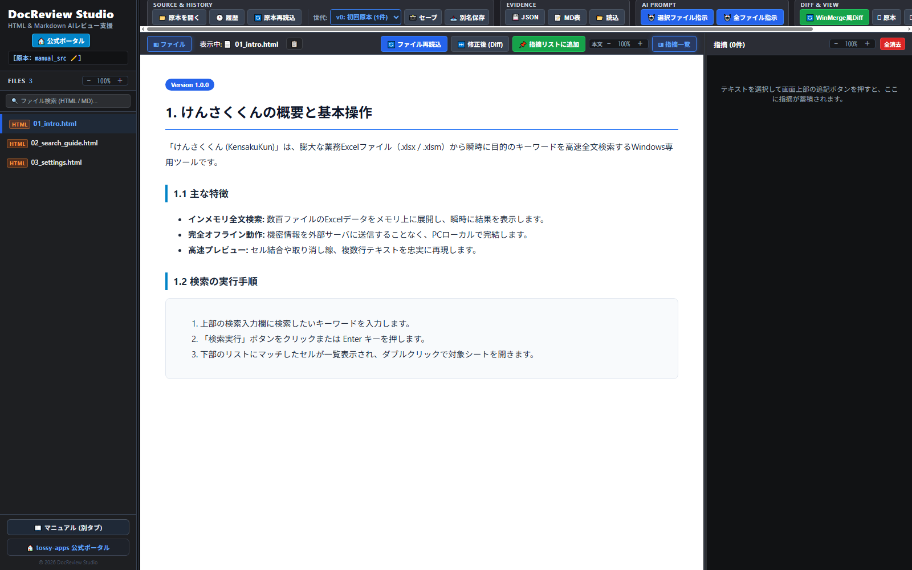
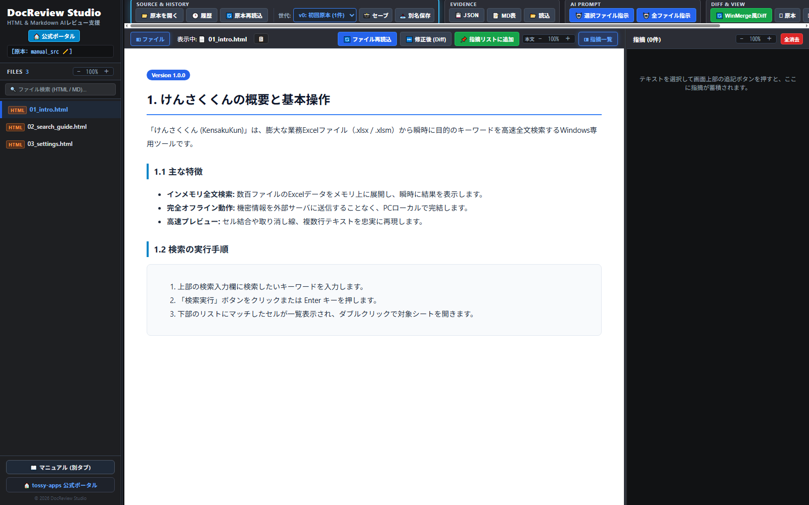
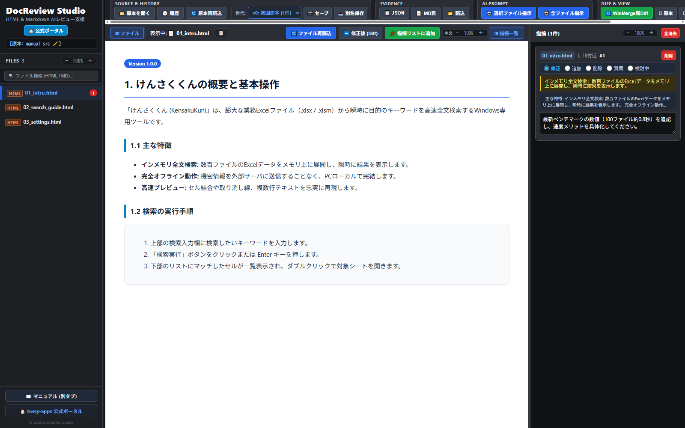
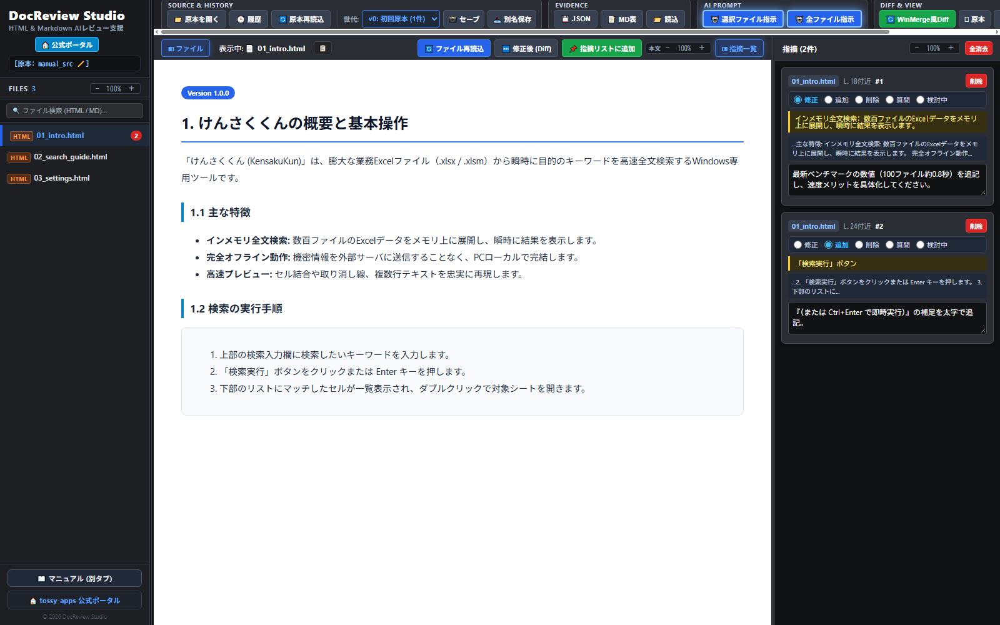
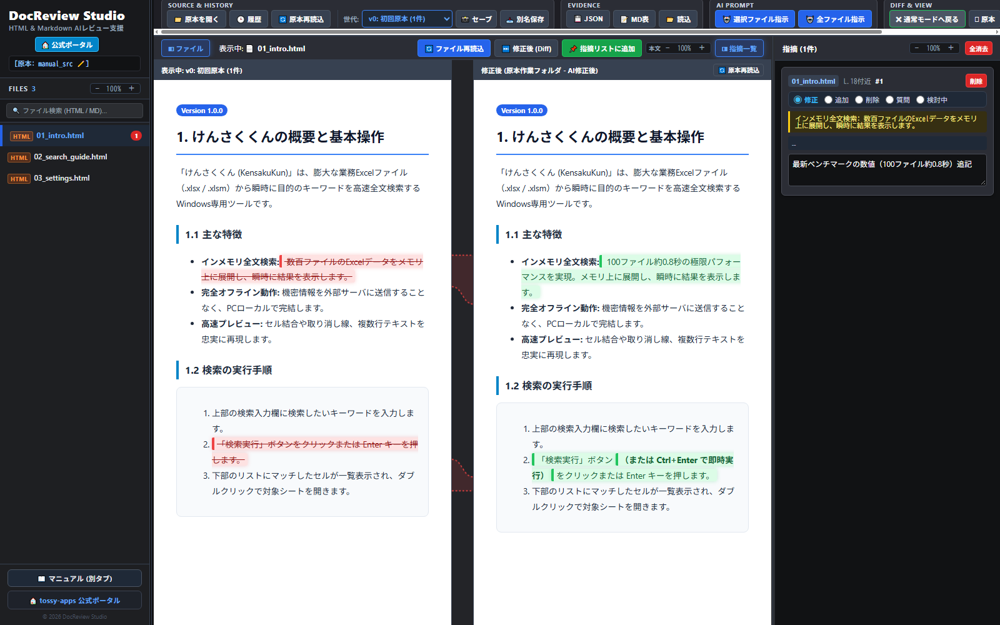
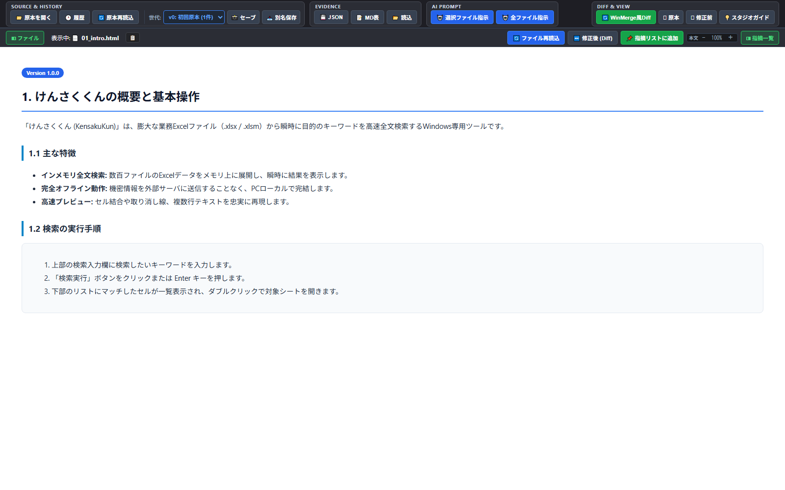

# DocReview Studio User Manual

> 🇯🇵 **[日本語版マニュアルはこちら (manual.md)](manual.md)** / **[HTML版 (manual.html)](manual.html)**

DocReview Studio is a **100% client-side, AI-collaborative document proofreading studio** that runs entirely within your web browser. It empowers technical writers, reviewers, and engineering teams to load local HTML manuals and Markdown documents (`.md` / `.markdown`), record feedback visually, automatically bundle structured revision prompts for LLMs (Claude, Gemini, ChatGPT), highlight inline diffs in real time, and verify changes side-by-side with a WinMerge-style visual diff inspector.

---

## 📑 Table of Contents

[1. Core Concepts & Architecture (Human-AI Review Cycle)](#sec-features)  
[2. UI Layout & 3-Pane Structure](#sec-layout)  
[3. Quick Start (Get Started in 3 Steps)](#sec-quickstart)  
[4. Core Review Workflow (Text Highlights, Image Reviews & Evidence)](#sec-review)  
[5. AI Prompt Integration (Automated LLM Revision Instructions)](#sec-aiprompt)  
[6. Visual Diff Inspection (Inline Highlighting & Side-by-Side Comparison)](#sec-diff)  
[7. Generation & Snapshot Management (Version Checkpoints & Safe Exports)](#sec-generations)  
[8. Keyboard Shortcuts, Independent Zoom & Multi-Window Tools](#sec-shortcuts)  

---

<h2 id="sec-features">1. Core Concepts & Architecture (Human-AI Review Cycle)</h2>



### 🤖 Human-in-the-Loop AI Collaboration Cycle
- **Human: Highlight & Instruct Intuitive Changes**: Simply drag and select text directly in the rendered preview and type your feedback. DocReview Studio automatically generates high-precision, actionable prompts (target file, approximate line number, selected text, surrounding context, and your instructions) formatted specifically for LLMs (Claude, Gemini, ChatGPT, etc.) so they never guess or break surrounding markup.
- **AI: Modify Code & Safely Verify via Visual Diff**: Once the AI modifies your local files, reload with a single click. Inspect the edits immediately via green inline highlights and side-by-side visual diffs to confirm that all feedback was addressed accurately without unexpected layout breaks or unintended edits.

### 🔒 Zero Server Transmission &bull; 100% Local Privacy
- Powered by the native **File System Access API**, files and folders are read and manipulated strictly within your browser's local memory.
- Proprietary manuals, confidential specifications, and private company documents never leave your workstation. No cloud upload, no telemetry, no tracking.

### 📝 High-Speed HTML & Markdown (.md) Rendering
- Seamlessly renders native HTML manuals and Markdown documents (`.md` / `.markdown`) using clean, GitHub-style typography and dark mode styling.
- Bundles a self-contained, offline Markdown parser (`marked.min.js`) that requires zero external network dependencies.

### 🚀 No Installer Required &bull; Cross-Platform (Windows & macOS)
- Runs immediately on any modern Chromium-based browser (**Google Chrome**, **Microsoft Edge**, **Brave**, etc.) across both **Windows** and **macOS** without installing drivers, runtimes, or backend services.
- *Note*: Because it relies on the File System Access API, Safari and Firefox are currently unsupported.

---

<h2 id="sec-layout">2. UI Layout & 3-Pane Structure</h2>

DocReview Studio features an ergonomically designed **3-pane workspace** tailored for extended, distraction-free proofreading sessions.

| Area | Component | Primary Functions |
| :--- | :--- | :--- |
| **Header** | Control Bar | Open source folder, workspace history, generation controls (Snapshot Save / Export As), Evidence export (JSON / MD), AI prompt copy, and WinMerge-style diff toggle. |
| **Left Pane** | File Tree | Hierarchical tree of HTML/Markdown documents with search filter, badge indicators (HTML / MD), and independent zoom widget. |
| **Center Pane** | Preview & Diff Inspector | Live HTML/Markdown document rendering, inline diff highlighting, side-by-side block diff comparison, and detached window views. |
| **Right Pane** | Evidence List | Card list of review feedback items with target text, line estimates, category pills, instructions, and independent zoom controls. |

> **💡 Dynamic Pane Resizing**: Drag the divider lines (resizers) between panes to flexibly adjust the widths of the file tree and evidence cards to suit your display setup.

---

<h2 id="sec-quickstart">3. Quick Start (Get Started in 3 Steps)</h2>



### STEP 1: Open Your Source Directory
1. Click the **"📁 Open Source"** button in the top header.
2. Choose the local directory containing your HTML or Markdown manuals and grant browser access when prompted.
3. The file hierarchy will populate in the left pane (filter anytime using the search box above).
4. If you have opened this directory previously, use the **"🕒 History"** button to restore your prior workspace state instantly.

### STEP 2: Select a Document to Review (Automatic v0 Backup)
1. Click any file in the left file tree.
2. The document renders immediately in the center pane. At the exact moment it is opened, its pristine original state is automatically captured and safeguarded as **"v0: Initial Source"** in memory.
3. This ensures that even if an AI overwrites the active file, you can always compare changes against the original benchmark without manual backups.

### STEP 3: Highlight Text & Log Feedback
1. Drag and highlight any phrase or sentence in the center preview, then click **"📌 Add to Feedback"**.
2. A new card is created in the right pane with auto-detected line numbers and context. Type your instruction (e.g., "Clarify benchmark numbers", "Fix typo").

---

<h2 id="sec-review">4. Core Review Workflow (Text Highlights, Image Reviews & Evidence)</h2>



### 1. Logging Feedback from Text Selection
1. Highlight target text in the center preview with your mouse cursor.
2. Click either the floating **"📌 Add to Feedback"** tooltip directly above the selection or the toolbar button **"📌 Add to Feedback List"**.
3. A new feedback card is appended to the right pane, and the instruction text area is automatically focused.

### 2. Reviewing Images & Figures (Right-Click Instant Log)
- **Click on an image**: A floating "📌 Add to Feedback" button appears above the upper-right corner of the image.
- **Right-click on an image**: Instantly captures the image file name, figure caption, and parent section heading, creating a pre-filled feedback card in one click.

### 3. Document-Wide General Feedback
To provide broad guidance for an entire document (e.g., "Unify tone across all sections", "Add SEO keywords to headings"):
- Click the **"Viewing: 📄 [filename]"** label in the center toolbar.
- Alternatively, click **"📌 Add to Feedback List"** without selecting any text.

### 4. Editing Feedback Cards
Each feedback card automatically tracks and displays:
- **Target File & Line Estimate**: Automatically calculated from position in original source (e.g., `~L.24`).
- **Category Pill (Radio)**: Categorize as `Fix` / `Add` / `Delete` / `Question` / `Pending`.
- **Selected Text (Yellow Highlight)**: Clicking this automatically scrolls the center preview to the exact passage with an animated pulse highlight.
- **Context Window**: Preserves preceding and following sentences for ambiguity-free AI targeting.
- **Instruction Field**: Detail the precise changes you want the author or LLM to execute.

### 5. Exporting & Restoring Evidence
Use the **Evidence** action group in the header to preserve and share review results:
- **💾 JSON**: Exports an exact, structured JSON file of all logged cards for storage or automated parsing.
- **📝 MD Table**: Exports a clean Markdown table ready to paste directly into GitHub Issues, PR descriptions, or review reports.
- **📂 Load**: Imports previously exported JSON files, fully restoring your review workspace and feedback cards.

---

<h2 id="sec-aiprompt">5. AI Prompt Integration (Automated LLM Revision Instructions)</h2>



Transform your logged feedback into production-grade prompts formatted specifically for LLMs (Claude 3.5/3.7, Gemini 2.0/3.0, ChatGPT o3/GPT-4o) to execute direct in-place modifications accurately.

### Copying Instructions to Clipboard
- **🤖 Selected File Prompt**: Formats only the review items belonging to the currently active document.
- **🤖 All Files Prompt**: Consolidates and structures all feedback items across your entire project into a single prompt.

#### Example of Generated LLM Prompt
```markdown
【Target File: 01_intro.html】
Please directly edit the specified file to apply the revisions listed below.

【Strict Execution Rules】
1. Single File Scope: Do not execute web searches or search/grep other files in the project.
2. Ignore External Links: Do not validate or alter external URL links (hrefs). Strictly perform simple text replacement on the target strings.
3. Preserve Markup & Identifiers: Keep existing HTML tags, attributes, class names, code blocks, and English code identifiers intact. Do not alter surrounding text unless instructed.

========================================
[Feedback #1] 【Fix】
Target File: 01_intro.html (~L.18)
Target Text:
"In-Memory Full-Text Search: Loads hundreds of Excel sheets into memory and returns results instantly."
Context:
"...Key Features: In-Memory Full-Text Search: Loads hundreds of Excel sheets into memory and returns results instantly. 100% Offline Operation..."
Instruction:
Add the latest benchmark metrics (~0.8s for 100 files) to demonstrate explicit performance advantages.
```

---

<h2 id="sec-diff">6. Visual Diff Inspection (Inline Highlighting & Side-by-Side Comparison)</h2>



After your AI assistant or team members complete the revisions, inspect and verify changes visually using two dedicated diff modes.

### 1. Real-Time Inline Diff Highlighting (Recommended)
- Click the **"⏭️ Modified (Diff)"** button in the center toolbar. Without leaving your reading flow, all updated or newly added sentences are **highlighted directly in green inside the document preview**.
- Click again to toggle to **"⏮️ Original"**, allowing instantaneous A/B comparison between revisions.

### 2. WinMerge-Style Side-by-Side Block Comparison
- Click **"🔄 WinMerge Diff"** in the top header to split the center area into a synchronized 2-pane comparison view:
  - **Left Pane**: Original baseline (Safeguarded v0 original or backup folder).
  - **Right Pane**: Modified document (Live working directory with latest edits).
  - **Center Canvas Bridge Lines**: Connects corresponding diff blocks with smooth bezier curves so you immediately spot where content was inserted or rewritten.
  - **Synchronized Scrolling**: Scrolling either side smoothly updates the opposite pane to keep matching sections in view.

### 3. High-Precision HTML Tokenizer Engine
- Powered by **Google `diff-match-patch`** combined with custom HTML token lexical analysis.
- Unlike naive text diffs that break upon encounter of tags, our engine tokenizes HTML markup and raw text separately, preventing broken DOM trees and eliminating false-positive color noise on unrelated headings.

### 4. 🔄 Instant Reload Buttons
- **🔄 Reload File** (Center Toolbar): High-speed single-file refresh from disk (updates immediately without rescanning large directories).
- **🔄 Reload Workspace** (Header): Full rescanning of all project folders to detect newly added or renamed files.

---

<h2 id="sec-generations">7. Generation & Snapshot Management (Version Checkpoints & Safe Exports)</h2>

Manage progressive document milestones directly in the browser without having to switch over to Git or command line tools.

### Lifecycle of Generations
1. **v0: Initial Original**: The untouched baseline recorded automatically upon first opening. It remains safeguarded as the ultimate comparison benchmark.
2. **📸 Save Snapshot**: After an AI applies a batch of fixes and you verify the outcome, click **"📸 Save"** to commit this milestone as "v1", "v2", etc.
3. **Active Working File**: The live disk file currently receiving edits.
4. **Generation Selector**: Select any prior generation from the dropdown menu to dynamically change which baseline version is compared against your working files.
5. **📥 Export As**: Export any historic snapshot safely under a distinct filename (e.g., `index_v0_snapshot.html`) without overwriting your original.

---

<h2 id="sec-shortcuts">8. Keyboard Shortcuts, Independent Zoom & Multi-Window Tools</h2>



### ⌨️ Keyboard Shortcuts (Windows & macOS Compatible)
| Action | Windows | macOS (Mac) |
| :--- | :--- | :--- |
| **Toggle Left Pane (File Tree)** | `Alt + 1` | `Option + 1` (`⌥1`) |
| **Toggle Right Pane (Evidence List)** | `Alt + 2` | `Option + 2` (`⌥2`) |
| **Independent Pane Zoom Under Cursor** | `Ctrl + Scroll Wheel`<br><small>or `Alt + Scroll Wheel`</small> | `Cmd + Scroll` (`⌘`)<br><small>or `Option + Scroll` (`⌥`)</small> |
| **Reset Pane Zoom to 100%** | `Ctrl + 0`<br><small>or Middle-Click / `Alt + 0`</small> | `Cmd + 0` (`⌘0`)<br><small>or Middle-Click / `Option + 0`</small> |

### 🔍 Independent 3-Zone Zoom System
Each pane (File Tree, Document Preview, and Evidence Cards) features its own dedicated **zoom widget (`−` `100%` `＋`)** in its header.
- Enlarge tiny document text without blowing up your file tree, or shrink cards on high-density displays for an expanded overview.
- The top header and toolbars stay locked at 100% scale and fully respect your native browser zoom settings without distortion.

### 🖥️ Multi-Display Detached Window Mode
- **"🪟 Working"**: Opens the current modified HTML preview in a dedicated, distraction-free external browser window.
- **"🪟 Original"**: Opens the pristine original document in an independent window.
- Ideal for dual-monitor workflows: place the original document full-screen on monitor 1 and the live modified version on monitor 2.
